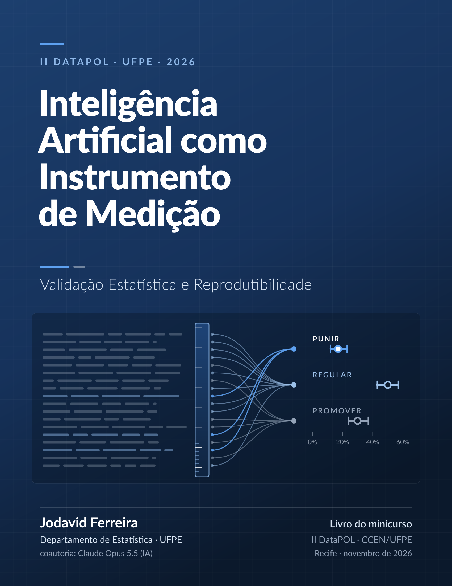

```{r setup, include=FALSE}
source("setup_livro.R")
```

# Apresentação {-}

```{r inicio, eval=knitr::is_html_output(), results="asis"}
# Bloco inicial (só no HTML): capa e acesso rápido ao material
cat('
<div class="inicio">
<div class="inicio-capa"></div>
<div class="inicio-texto">
<p>Livro do minicurso de 4 horas da <strong>II DataPOL</strong>: do dado legislativo bruto à inferência com rótulos produzidos por LLMs, em R e Python, com todo o código e os dados abertos.</p>
<div class="botoes">
<a class="principal" href="intro.html">Começar a leitura →</a>
<a href="ia-instrumento-medicao.pdf" target="_blank" rel="noopener">Livro em PDF</a>
<a href="material/minicurso_IA_medicao.zip">Material completo (.zip)</a>
</div>
<div class="botoes">
<a href="slides/parte1_conceitos.html" target="_blank" rel="noopener">Slides · Parte 1: conceitos</a>
<a href="slides/completo_R.html" target="_blank" rel="noopener">Slides completos · R</a>
<a href="slides/completo_python.html" target="_blank" rel="noopener">Slides completos · Python</a>
<a href="slides/slides.html" target="_blank" rel="noopener">Slides · versão resumida</a>
</div>
</div>
</div>
')
```

Modelos de linguagem de grande porte (LLMs) passaram a fazer parte da rotina de pesquisa: classificam discursos, extraem informações e anotam grandes corpora em minutos. Mas um LLM é, antes de tudo, um **instrumento de medição**. Como um questionário ou um codificador humano, ele tem erro, viés e confiabilidade, e tudo isso precisa ser medido antes que seus rótulos virem conclusões.

Este livro acompanha o minicurso **"Inteligência Artificial como Instrumento de Medição: Validação Estatística e Reprodutibilidade"** (4 horas), oferecido na **II DataPOL, Escola de Métodos Quantitativos em Ciência Política e Relações Internacionais**, de 24 a 26 de novembro de 2026, no Auditório do CCEN/UFPE, em Recife. Ele percorre, em R e Python, o caminho completo do dado bruto à inferência:

1. **coleta** de dados legislativos brasileiros pelas APIs da Câmara e do Senado;
2. construção de um **livro de códigos** e de uma **amostra-ouro** codificada por humanos;
3. ***baselines*** clássicos (dicionário e TF-IDF com regressão logística);
4. **anotação com um LLM aberto**, rodando localmente, com prompts versionados e cache;
5. **validação estatística**: concordância, viés diferencial e confiabilidade;
6. **inferência** que corrige o erro do LLM (*Prediction-Powered Inference*);
7. **reprodutibilidade** (MLOps) e
8. **ética e limites**, à luz das eleições de 2026 e do debate regulatório sobre IA no Brasil.

## O estudo de caso {-}

> **Quando o Congresso legisla sobre IA, ele quer PUNIR, REGULAR ou PROMOVER?**

- **Corpus:** `r nrow(corpus)` projetos de lei sobre inteligência artificial, deepfakes e conteúdo sintético (Câmara e Senado, 2019–2026), coletados das APIs de dados abertos em 06/11/2026.
- **Instrumento:** um LLM aberto rodando localmente, o S5-nano, da Maritaca AI: um modelo brasileiro, derivado do Qwen3.5-4B e treinado com dados em português, usado em modo *instruct*, quantizado em 4 bits e servido pelo Ollama, com três versões de prompt (Capítulo \@ref(llm)).
- **Referência:** todas as `r nrow(ref)` ementas codificadas com um livro de códigos (codificação preliminar feita por outra IA, o Claude Opus 5.5, ainda sem revisão humana); `r nrow(ouro)` delas formam a amostra-ouro.
- **Inferência:** que proporção da produção legislativa é punitiva, e se isso varia entre campos políticos, com intervalos de confiança que levam em conta o erro do LLM.

::: {.caixa .aviso}
[Aviso: resultados ilustrativos]{.titulo-caixa}
A codificação de referência usada neste livro é **preliminar**: foi feita por **outra IA**, o Claude Opus 5.5, aplicando o livro de códigos às ementas, para que o pipeline funcionasse de ponta a ponta, e ainda deve ser revisada por codificadores humanos independentes (Seção \@ref(referencia)). Por isso, os números aqui apresentados servem para **ensinar o método**, não como achados substantivos definitivos sobre o Congresso. Quando a referência for revisada, basta rodar o pipeline de novo: as tabelas, as figuras e os números deste livro se atualizam automaticamente.
:::

## A quem se destina {-}

A estudantes e pesquisadores de Ciência Política, Relações Internacionais e áreas afins que querem usar LLMs para medir conceitos em textos **e defender essas medidas** num artigo. Os pré-requisitos são noções de R **ou** Python e de estatística básica (proporção, intervalo de confiança). Não é preciso GPU nem chave de API: todo o material roda a partir de dados e respostas do LLM congelados.

## Como usar este livro {-}

Cada capítulo corresponde a um bloco do minicurso e aponta para os scripts que produzem os resultados. Do Capítulo \@ref(dados) ao \@ref(reprodutibilidade), cada um termina com uma seção **"Mão na massa"**, que traz:

- o **código** que você executa, em **R** e em **Python** (escolha a aba da sua linguagem; no PDF, os dois aparecem em sequência);
- as **saídas** reais desse código, geradas ao compilar o livro a partir dos dados do material;
- uma caixa **"Como executar"**, com o script ou notebook correspondente e o que ele grava;
- um parágrafo **"O que está sendo executado"**, que explica o essencial de cada trecho.

Chamadas às APIs do Congresso e ao LLM não são executadas na compilação: o código aparece, e a saída mostrada é a **registrada** nos arquivos congelados do material. Para instalar o necessário, veja o Apêndice \@ref(ambiente).

### Dois formatos para o minicurso {-}

O mesmo conteúdo pode ser apresentado de duas formas, com slides próprios para cada uma:

- **Formato A: 2 horas de conceitos + 2 horas de prática.** Na primeira parte, os [slides da Parte 1](slides/parte1_conceitos.html) apresentam as ideias e o que será feito em cada bloco, sem mostrar resultados. Na segunda, a turma executa os scripts de `R/` ou os notebooks de `python/`, bloco a bloco, acompanhando as seções "Mão na massa" deste livro.
- **Formato B: 4 horas só com slides.** O minicurso inteiro é conduzido pelos slides completos, que trazem o código, o que está sendo executado e as saídas, em duas versões: [em R](slides/completo_R.html) e [em Python](slides/completo_python.html).

Há ainda uma [versão resumida dos slides](slides/slides.html), com os resultados principais e sem código, útil para uma apresentação curta.

### Material {-}

- **Material completo** (R, Python, dados, cache do LLM): [baixar o arquivo .zip](material/minicurso_IA_medicao.zip)
- **Como reproduzir** tudo, com ou sem LLM: Apêndice \@ref(reproduzir)

As tabelas e figuras do livro são lidas diretamente dos resultados do pipeline, o que garante que livro, slides e código digam a mesma coisa.

## Autoria e uso de inteligência artificial {-}

::: {.caixa .ia}
[Transparência sobre o uso de IA]{.titulo-caixa}
Este livro e o material do minicurso foram elaborados por **Jodavid Ferreira** em coautoria com o **Claude Opus 5.5**, modelo de inteligência artificial da Anthropic (identificador `claude-opus-5-5`), utilizado por meio do Claude Code. A IA atuou como **auxiliar**: na escrita e revisão de código, na redação e organização do texto, na verificação da reprodutibilidade e na compilação deste livro.

A concepção do minicurso, as escolhas metodológicas, a curadoria do conteúdo e a revisão final são do autor humano, que assume **integral responsabilidade** pelo conteúdo, incluindo eventuais erros. A declaração completa está no Apêndice \@ref(declaracao-ia).
:::

Há uma coerência deliberada aqui: o minicurso defende que a IA seja tratada como um instrumento cujo uso precisa ser **documentado, verificado e assumido** por quem a usa. Esta seção aplica a mesma regra ao próprio livro.

Note que dois modelos de IA aparecem neste material, em papéis diferentes. O S5-nano é o **instrumento de medição** estudado (o objeto do minicurso). O Claude Opus 5.5 foi o **coautor** que auxiliou na produção do material e que também fez a **codificação preliminar de referência** das ementas, ainda não revisada por humanos. Nenhum deles substitui a responsabilidade do autor.

## Como citar {-}

> Ferreira, J.; Claude Opus 5.5 (2026). *Inteligência Artificial como Instrumento de Medição: Validação Estatística e Reprodutibilidade*. Livro do minicurso da II DataPOL, Universidade Federal de Pernambuco, Recife. Texto e código produzidos com o auxílio de IA; responsabilidade do autor. Licença CC BY 4.0 (texto) e MIT (código).

## Licença {-}

O **texto** deste livro está licenciado sob a [Creative Commons Atribuição 4.0 Internacional (CC BY 4.0)](https://creativecommons.org/licenses/by/4.0/deed.pt-br): você pode copiar, adaptar e redistribuir para qualquer fim, desde que dê o crédito apropriado. O **código** (em R e Python, no livro e no material) está licenciado sob a [Licença MIT](https://opensource.org/license/mit). Os dados brutos, obtidos das APIs de dados abertos da Câmara e do Senado, seguem os termos dessas fontes. Detalhes no arquivo `LICENSE.md` do material.

**Contato:** Jodavid Ferreira · jodavid.ferreira@ufpe.br · [jodavid.github.io](https://jodavid.github.io)
