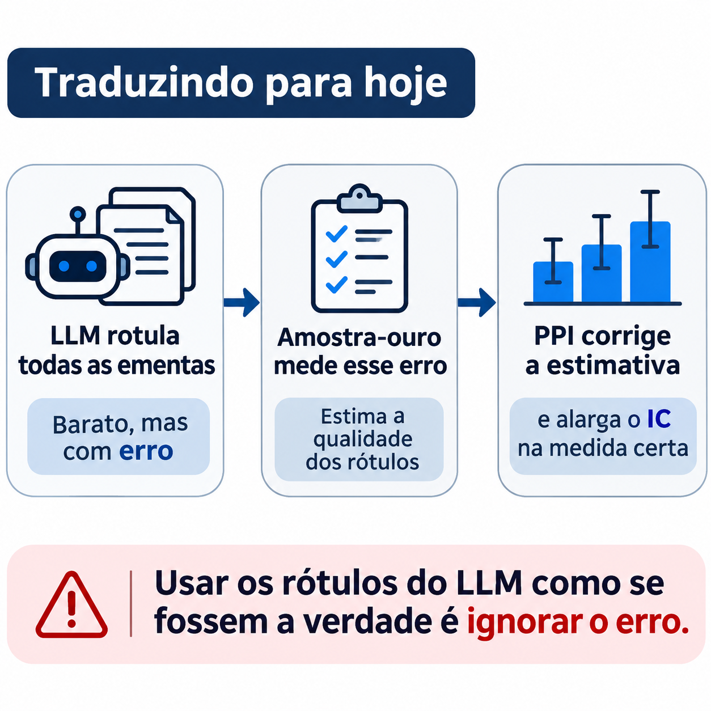
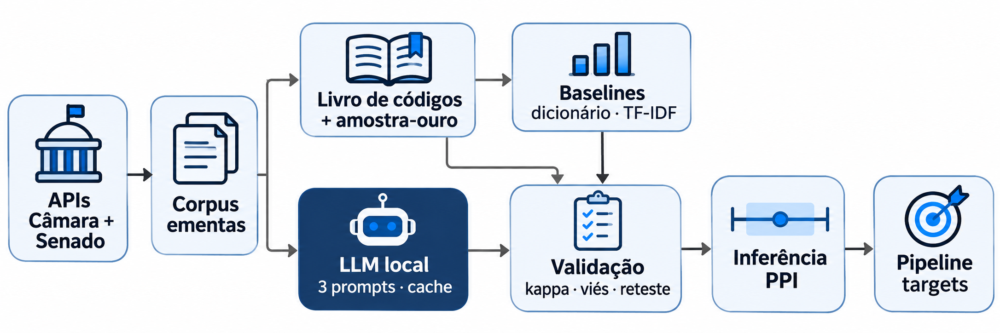
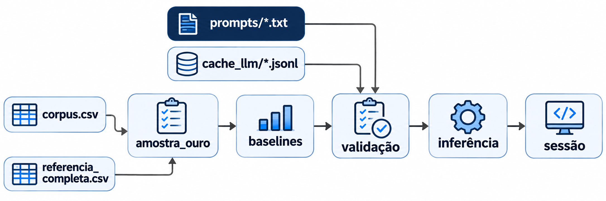

```{r}
#| include: false
# Só números DESCRITIVOS do corpus e da referência (nenhum resultado de validação ou inferência).
# Derivado de completo_R.qmd (partes_R/): mesma sequência e texto, só os slides conceituais.
suppressPackageStartupMessages({
  source("../R/funcoes_medicao.R")   # CATEGORIAS e alfa_krippendorff (exemplo fictício do bloco 5)
  source("../R/tema_graficos.R")     # tema e paleta da figura do bloco 1
})
knitr::opts_chunk$set(fig.align = "center", fig.width = 10, fig.height = 4.6,
                      out.width = "85%", dpi = 150)
corpus <- read_csv("../dados/processado/corpus.csv", show_col_types = FALSE)
ref    <- read_csv("../dados/anotacoes/referencia_completa.csv", show_col_types = FALSE)
ouro   <- read_csv("../dados/anotacoes/amostra_ouro.csv", show_col_types = FALSE)
antigo <- read_csv("../dados/processado/historico/corpus_2026-10-08.csv", show_col_types = FALSE)
n_corpus <- nrow(corpus)
n_camara <- sum(corpus$casa == "Câmara")
n_senado <- sum(corpus$casa == "Senado")
n_2026   <- sum(corpus$ano == 2026)
CATS <- CATEGORIAS
pc   <- function(x, d = 1) paste0(format(round(100 * x, d), nsmall = d, decimal.mark = ","), "%")
nf   <- function(x, d = 2) format(round(x, d), nsmall = d, decimal.mark = ",")
cont <- function(x) as.integer(table(factor(x, CATS)))
outros <- merge(corpus, ref[ref$categoria == "OUTRO", ], by = "doc_id")
# Recoleta (08/10 × 06/11/2026): descrição do corpus, não resultado de medição
novos    <- anti_join(corpus, antigo, by = "identificacao")
comum    <- inner_join(antigo, corpus, by = "identificacao", suffix = c("_out", "_nov"))
muda_sit <- sum(coalesce(comum$situacao_out, "") != coalesce(comum$situacao_nov, ""))
n_campo  <- table(factor(corpus$campo, c("Esquerda", "Centro", "Direita", "Sem partido/Outro")))
# Exemplo fictício do alfa (bloco 5)
m_alfa <- rbind(c("PUNIR",   "PUNIR",   "PUNIR"),
                c("REGULAR", "REGULAR", "PROMOVER"),
                c("REGULAR", "REGULAR", "REGULAR"),
                c("OUTRO",   "OUTRO",   NA),
                c("PROMOVER","REGULAR", "PROMOVER"),
                c("REGULAR", "REGULAR", "REGULAR"))
alfa3 <- alfa_krippendorff(m_alfa)
alfa2 <- alfa_krippendorff(m_alfa[, 1:2])
```

## {background-color="#1c3f6e"}

<br/>
<br/>

::: {style="color:white; font-size:1.6em; margin-top:2em"}
"O futuro traz novas perguntas.<br>Os dados ampliam nossas formas de responder."
:::

::: {style="color:#c9d7ec; margin-top:1.5em"}
...mas **quem mede a régua?**
:::

. . .

<br/>

> ou seja, quem estabelece os critérios utilizados para avaliar os resultados? Quem define o que é sucesso? Qual métrica devemos utilizar? O que consideramos uma resposta correta? Quem determina os padrões?


## Uma conferência, 29 mil artigos: volume não é ciência {background-color="#1c3f6e"}

<hr/>
<br/>

<div style="font-size: 100px;">[≈ 29 mil]{.hero .verm}</div>

[submissões à trilha principal da AAAI-26, quase o dobro de 2025]{.hero-leg}

<div style="color: gray;">
[AAAI; OpenReview (2026)]{.hero-fonte}
</div>

<br/>

<div style="font-size: 100px;">[6,5–16,9%]{.hero .m .cinza}</div>

do texto de revisões em conferências de IA (2023–24) modificado por LLMs.


<br/>


::: notes
**0:30** · "A AAAI de 2026 recebeu quase 29 mil artigos na trilha principal, quase o dobro do ano anterior. E estima-se que uma fração relevante das próprias revisões já é escrita com ajuda de LLMs; até essa detecção é um problema de estimação. Volume não é ciência."

Primeiro corte se estiver atrasado.
:::


## Duas perguntas para hoje

<br/>

::: {.columns}
::: {.column width="49%"}
### Substantiva

<br/>

Quando o Congresso legisla sobre **IA**, ele quer **punir**, **regular** ou **promover**?

<br/>

E isso varia entre campos políticos?

:::
::: {.column width="2%"}


:::
::: {.column width="49%"}

### Metodológica

<br/>

Se usarmos um **LLM** para responder, **como sabemos se a resposta está certa**?

<br/>

E como **reproduzir** a resposta daqui a dois anos?
:::
:::

## Por que agora?

<br/>

- **Eleições de 2026**: primeiras eleições gerais sob a Res. TSE nº 23.755/2026 (rotulagem obrigatória, deepfakes proibidos, IA não pode recomendar voto).
  <span style="color: #808080; font-size: 0.85em;">Novas regras estabelecem limites para o uso de inteligência artificial na comunicação eleitoral.</span>

- **Marco Legal da IA (PL 2338/2023)**: aprovado no Senado em dez/2024, **aguardando parecer** na Câmara.
  <span style="color: #808080; font-size: 0.85em;">A proposta busca estabelecer regras para o desenvolvimento e o uso da inteligência artificial no Brasil.</span>

- **`r n_corpus` projetos de lei** sobre IA no Congresso, `r n_2026` só em 2026.
  <span style="color: #808080; font-size: 0.85em;">O volume de propostas mostra o crescente interesse legislativo pela regulamentação da IA.</span>

- LLMs viraram infraestrutura de pesquisa, mas são **instáveis, sensíveis ao prompt e enviesados**.
  <span style="color: #808080; font-size: 0.85em;">Seus resultados exigem validação, avaliação crítica e atenção à qualidade das respostas.</span>


## A "fase atual" da estatística

<br/>

::: {.columns}
::: {.column width="55%"}
- **Breiman (2001)**: duas culturas, *modelar* × *prever*

::: {.pequeno}
*Modelar* = explicar como os dados são gerados e medir a incerteza (a estatística clássica).

*Prever* = acertar a resposta, mesmo sem entender o mecanismo (o aprendizado de máquina).
:::

- **2018–2026**: a síntese, com ML **a serviço da inferência**

::: {.pequeno}
As previsões do ML viram matéria-prima para estimar efeitos e proporções **com intervalo de confiança válido**
:::
:::
::: {.column width="45%"}
::: {.callout-note title="O fio comum"}
Previsões de modelos podem tornar a inferência **mais precisa**, desde que o erro delas seja **medido e corrigido**, e não ignorado.
:::

::: {.pequeno}
{width="58%"}
:::
:::
:::

## O que significa medir um instrumento

<br/>

| Propriedade | Pergunta | Como vamos medir hoje |
|---|---|---|
| **Validade** | Mede o que diz medir? | kappa, F1 e acurácia contra a amostra-ouro, com IC bootstrap |
| **Onde erra** | Que erros comete? | matriz de confusão |
| **Viés diferencial** | Erra igual para todos? | acurácia e viés por campo político |
| **Confiabilidade** | Mede sempre igual? | alfa de Krippendorff entre sementes e entre prompts |
| **Consequência** | O erro muda a conclusão? | ingênuo × PPI × PPI++, simulação de cobertura |
| **Reprodutibilidade** | Outra pessoa chega ao mesmo número? | cache, hashes, `targets`, repetição |

## O caminho de hoje

<br/>

{width="90%"}


# 1 · Dados legislativos {background-color="#1c3f6e"}

## Duas APIs abertas, sem chave

<br/>

::: {.columns}
::: {.column width="50%"}
### Câmara dos Deputados
`dadosabertos.camara.leg.br/api/v2`

- `/proposicoes`: busca por palavra-chave, ano, tipo
- `/proposicoes/{id}/autores`
- `/proposicoes/{id}` (situação)
- `/deputados/{id}/historico`
:::
::: {.column width="50%"}
### Senado Federal
`legis.senado.leg.br/dadosabertos`

- `/processo`: busca por termo, sigla e datas
- a **autoria já vem com partido e UF** na data: "Senador Fulano (PSD/MG)"
:::
:::

<br/>

**Termos:** *inteligência artificial*, *deepfake*, *deep fake*, *conteúdo sintético* · **Tipo:** PL · **Anos:** 2019–2026

## Anatomia de uma requisição

<br/>

```text
https://dadosabertos.camara.leg.br/api/v2/proposicoes?keywords=deepfake&ano=2024&siglaTipo=PL&itens=100&pagina=1
└──────────────── URL base ──────────────┘└ endpoint ┘└──────────────── parâmetros (query) ─────────────────┘
```

| Parâmetro | Papel | Decisão de medição |
|---|---|---|
| `keywords` | termo de busca | o **indexador** da Câmara decide o que "contém" o termo |
| `ano` | ano de apresentação | o filtro por **data** aceita no máximo 3 meses |
| `siglaTipo` | PL, PEC, PLP... | só **projetos de lei** |
| `itens`, `pagina` | paginação | no máximo 100 por página |

::: {.pequeno}
**Boas práticas:** identificar quem chama · no máximo 5 requisições por segundo · tentar de novo em falhas temporárias (429, 5xx), com espera crescente (2, 4, 8 s...) · paginar até vir uma página com **menos de 100** itens
:::

## O partido de quem? E quando?

<br/>
<br/>

Queremos o partido do autor **na data de apresentação**, não o partido de hoje.

<br/>

::: {.incremental}
- A API da Câmara tem o **histórico** de cada deputado: `/deputados/{id}/historico`
- Armadilha: o histórico traz registros "partido no início da legislatura" **datados de 2023-02-01 para legislaturas antigas**, com `situacao` vazia
- Sem filtrar esses registros, um deputado do **PL em 2023** aparecia como **PMDB** ou **PFL** num projeto de 2023
- A solução é uma linha de código, mas só aparece para quem **olha os dados**
:::

## Testando a regra

<br/>

Um histórico **fictício**, com o registro problemático da API, para um projeto apresentado em **2023-05-10**:

::: {.columns}
::: {.column width="55%"}
| Data registrada | Partido | Situação |
|---|---|---|
| 2007-02-01 | PFL | *(vazia)* |
| 2023-02-01 | PMDB | *(vazia)* |
| 2019-02-01 | PSL | Exercício |
| 2022-03-30 | PL | Exercício |

<br/>

- **Ingênua** (último registro até a data): **PMDB** ✗
- **Correta** (só registros com situação): **PL** ✓
:::
::: {.column width="45%"}
::: {.callout-warning title="Lição"}
O erro não aparece como "erro": o código roda, a tabela sai bonita, e a variável **campo político** fica errada em silêncio.

Ler a documentação **e os dados** é parte do método.
:::
:::
:::

## Montando o corpus

<br/>

```text
corpus <- junta(senado, câmara)
          → remove duplicatas       (PL do Senado remetido à Câmara: fica a casa de origem)
          → limpa a ementa          (fica a ementa ORIGINAL, a que o autor apresentou)
          → filtra anos e ementas vazias
          → ordena pela data        (doc_id estável numa recoleta)
          → grava com a data da coleta
```

<br/>

- **Duplicatas:** o Marco Legal da IA (PL 2338/2023) aparece nas duas casas; mantemos o registro do **Senado** (casa de origem), que traz o partido do autor na data
- ***Decisão de medição:*** algumas ementas foram **reescritas** na tramitação; ficamos com a **original**
- Resultado: **`r n_corpus` ementas**, uma por projeto (`r n_camara` da Câmara, `r n_senado` do Senado)

## Campo político: uma medida dentro da medida

<br/>

| Campo | Partidos | Projetos |
|---|---|---|
| **Esquerda** | PSOL, PT, PCdoB, PDT, PSB, REDE, PV | `r n_campo[["Esquerda"]]` |
| **Centro** | MDB, PSDB, Cidadania, PSD, Solidariedade, Avante, PMB | `r n_campo[["Centro"]]` |
| **Direita** | PL, PP, União, Republicanos, Novo, PSC, PTB, Podemos, Patriota, PRD, DEM, PSL, PROS, PRTB, Agir, DC, PMN, Mobiliza | `r n_campo[["Direita"]]` |
| **Sem partido/Outro** | comissões, Executivo, Senado Federal como autor | `r n_campo[["Sem partido/Outro"]]` |

<br/>

- Atribuído ao **partido do autor na data**: herda o erro da regra do slide anterior
- Simplificação didática de Bolognesi, Ribeiro & Codato (2023): a classificação é ela própria uma **medida**, com erro

## A explosão legislativa

```{r}
corpus |>
  left_join(select(ref, doc_id, categoria), by = "doc_id") |>
  count(ano, categoria = factor(categoria, levels = CATEGORIAS)) |>
  ggplot(aes(factor(ano), n, fill = categoria == "PUNIR")) +
  geom_col(width = .7) +
  facet_wrap(~categoria, nrow = 1) +
  scale_fill_manual(values = c(`TRUE` = AZUIS[3], `FALSE` = CINZA_CLARO), guide = "none") +
  labs(title = "Projetos de lei sobre IA no Congresso, por ano e categoria (referência)",
       x = NULL, y = "Projetos") +
  tema_minicurso() +
  theme(axis.text.x = element_text(angle = 90, vjust = .5))
```

## A coleta também é medição

<br/>

::: {.incremental}
- **Limite de 3 meses** no filtro de data → filtrar por `ano`
- **Partido "na data"**: registros de 2023 para legislaturas antigas → filtrar `situacao`
- **Busca por palavra-chave** depende de um indexador: falsos positivos (Lei Geral das Atividades Nucleares?) e possíveis omissões → categoria **OUTRO**
- **Duplicatas** entre casas → fica o registro da casa de origem
- **Erros 5xx** no meio da coleta (na recoleta de 06/11, a Câmara respondeu **504**) → tentar de novo
- **APIs mudam**: em um mês, `r nrow(novos)` projetos novos e `r muda_sit` situações de tramitação diferentes → **congelar com data**
:::

## Por que congelar os dados

<br/>

- APIs mudam: projetos são arquivados, ementas reescritas, índices refeitos
- Guardamos as **respostas brutas** e o **corpus processado** com a **data da coleta**
- Em sala e em qualquer replicação, partimos desses arquivos
- Recoletar é possível, mas **gera outro corpus**

<br/>

::: {.callout-tip title="Na Parte 2"}
`R/01_coleta.R` · `python/01_coleta.ipynb`

Uma chamada ao vivo, leitura do corpus congelado e comparação entre as duas coletas feitas com um mês de diferença.
:::

# 2 · Codificar é medir {background-color="#1c3f6e"}

## Livro de códigos

| Código | Instrumento central | Exemplo |
|---|---|---|
| **PUNIR** | *penal:* crime, pena, Código Penal, parte penal do ECA | "tipifica o crime de deepfake sexual" |
| **REGULAR** | *regras não penais:* deveres, rotulagem, direitos, responsabilidade civil | "obriga identificar conteúdo gerado por IA" |
| **PROMOVER** | fomento, ensino, adoção de IA pelo Estado | "inclui IA no currículo do ensino médio" |
| **OUTRO** | não trata de IA, algoritmos ou conteúdo sintético | falsos positivos da busca |

**Unidade de análise:** a **ementa**, sozinha. Sem inteiro teor, sem olhar o autor.

::: {.callout-note title="Por que este bloco vem antes do LLM"}
Um LLM só pode ser avaliado contra uma **referência**. E uma referência só existe se o conceito tiver uma **definição operacional** escrita.
:::

## Regras de decisão

<br/>

1. **Precedência:** PUNIR > REGULAR > PROMOVER
2. "Responsabilização" ou "penalidades" **sem** crime, pena ou Código Penal → **REGULAR**
3. Marcos gerais ("princípios, direitos e deveres") → **REGULAR**
4. Proteção de trabalhadores diante da automação → **REGULAR**
5. Obrigar o Estado ou empresas a **usar** IA → **PROMOVER**
6. Deepfake, montagem, nudez falsa = conteúdo sintético, mesmo sem "inteligência artificial"
7. Na dúvida com OUTRO: *a ementa, sozinha, deixa claro que o objeto é IA?*

**Segunda variável:** `eleitoral` (0/1), independente da categoria: eleições, campanhas, candidatos, Código Eleitoral, violência política.

## De onde vêm os rótulos de referência?

<br/>


::: {.columns}
::: {.column width="56%"}
::: {.pequeno}
- As `r nrow(ref)` ementas têm um rótulo de **referência**: é a "régua" do minicurso
- **Quem codificou:** outra IA, o **Claude Opus 5.5** (Anthropic), coautor deste material. **Não** é o S5-nano, o instrumento que vamos avaliar
- **Como:** aplicando o **livro de códigos** ementa por ementa, lendo **só a ementa** (sem autor, sem inteiro teor)
- **Quando:** 298 ementas da coleta de 08/10/2026 e as 6 novas da coleta de 06/11/2026
:::
:::
::: {.column width="44%"}
::: {.callout-warning title="O que isso muda"}
Sem revisão humana, o kappa do bloco 5 mede a concordância **entre duas IAs** (S5-nano × Claude), não a validade contra humanos. Se as duas erram nos mesmos casos, a concordância **infla**.

Os números **ensinam o método**; não são achados sobre o Congresso.
:::

::: {.callout-note title="Pergunta para a turma"}
Por que não aceitar o rótulo do Claude como "verdade" e dispensar os humanos?
:::
:::
:::

## Quantos de cada classe?

<br/>

```{r}
tab_casa <- corpus |>
  inner_join(ref, by = "doc_id") |>
  count(categoria = factor(categoria, levels = CATEGORIAS), casa) |>
  tidyr::pivot_wider(names_from = casa, values_from = n, values_fill = 0) |>
  mutate(Total = Câmara + Senado, `%` = pc(Total / sum(Total)))
tab_casa <- bind_rows(mutate(tab_casa, categoria = paste0("**", categoria, "**")),
                      tibble(categoria = "**Total**", Câmara = sum(tab_casa$Câmara),
                             Senado = sum(tab_casa$Senado), Total = sum(tab_casa$Total), `%` = "100%"))
knitr::kable(tab_casa, align = "lrrrr", col.names = c("Categoria (referência)", "Câmara", "Senado", "Total", "%"))
```

<br/>

::: {.pequeno}
- **Total:** `r nrow(ref)` ementas · **REGULAR é metade** do corpus: chutar sempre REGULAR é o **piso** de qualquer instrumento
:::

## O que foi parar em OUTRO?

<br/>

`r nrow(outros)` ementas (`r pc(nrow(outros) / n_corpus)` do corpus, `r sum(outros$ano == 2026)` delas de 2026) vieram na busca, mas a **ementa, sozinha, não trata de IA nem de conteúdo sintético** (regra 7).

::: {.pequeno}
| Tipo | Exemplos reais do corpus (ementas resumidas) |
|---|---|
| **Temas digitais vizinhos**, sem IA na ementa | violência contra a mulher em ambiente digital · crimes cibernéticos · LGPD para crianças · inclusão e soberania digital · nuvem soberana |
| **Leis penais** que não citam IA nem conteúdo sintético | aumento de pena dos arts. 216-B e 218-C do Código Penal · estelionato · usura · ameaça pelo Pix |
| **Falsos positivos puros** | Lei Geral das Atividades Nucleares · transplante de órgãos · Código de Trânsito · processo administrativo |
:::

::: {.columns}
::: {.column width="55%"}
::: {.pequeno}
**Por que vieram?** A busca das APIs não olha só a ementa (o indexador usa também outros campos, como a indexação do projeto), e o texto completo pode até tratar de IA. Mas a unidade de análise é a **ementa**.
:::
:::
::: {.column width="45%"}
::: {.callout-note title="Pergunta para a turma"}
A proporção PUNIR deve ser calculada sobre as `r nrow(ref)` ementas ou só sobre as que tratam de IA?
:::

::: {.fragment .pequeno}
Sobre `r nrow(ref)`: `r pc(mean(ref$categoria == "PUNIR"))` · sobre `r sum(ref$categoria != "OUTRO")`: `r pc(sum(ref$categoria == "PUNIR") / sum(ref$categoria != "OUTRO"))`. O denominador é uma **decisão de medição** (aqui, as `r nrow(ref)`).
:::
:::
:::

## A amostra-ouro: um sorteio

<br/>

::: {.columns}
::: {.column width="55%"}
```text
N_OURO  <- 120     # ~40% do corpus: custo humano × precisão
semente <- 2026
ouro    <- sorteia(corpus, n = N_OURO)
```

<br/>

- É contra ela que **todo** instrumento automático será avaliado
- **Aleatória:** nem a "mais fácil", nem a "mais interessante". É o que permite que o erro medido nela valha para o corpus todo
- **Semente fixa:** qualquer pessoa sorteia **as mesmas** 120 ementas
:::
::: {.column width="45%"}
<br/>

::: {.callout-note title="Pergunta para a turma"}
Com metade das ementas codificadas por humanos, ainda precisaríamos do LLM? E com 30?
:::
:::
:::

## A amostra-ouro representa o corpus?

<br/>

```{r}
tab <- data.frame(
  Categoria = paste0("**", c(CATS, "Total"), "**"),
  n_c = c(cont(ref$categoria), nrow(ref)),
  p_c = c(pc(cont(ref$categoria) / nrow(ref)), "100%"),
  n_o = c(cont(ouro$categoria), nrow(ouro)),
  p_o = c(pc(cont(ouro$categoria) / nrow(ouro)), "100%"))
knitr::kable(tab, align = "lrrrr",
             col.names = c("Categoria (referência)", "Corpus (n)", "Corpus (%)",
                           "Amostra-ouro (n)", "Amostra-ouro (%)"))
```

<br/>

::: {.pequeno}
Proporções parecidas, como se espera de um sorteio. Diferenças existem, e é por isso que a inferência leva a amostra em conta.
:::

## Quanto **nós** concordamos?

<br/>
<br/>

**Levantem a mão:** PUNIR, REGULAR, PROMOVER ou OUTRO?

1. *"Estabelece condições, deveres e restrições ao uso de óculos inteligentes com recursos de inteligência artificial, altera o Código de Trânsito Brasileiro e o Código Penal..."* (doc0185)

2. *"Dispõe sobre medidas de prevenção, combate e responsabilização relacionadas à criação e disseminação de manipulação digital de conteúdo sexual (deepfakes)..."* (doc0233)

<br/>

. . .

::: {.fragment .pequeno}
**Referência:**

1 → **PUNIR** (altera o Código Penal; PUNIR precede REGULAR)

2 → **REGULAR** ("responsabilização" sem crime nem pena; regra 2).
:::

## Por que isso importa

<br/>

::: {.callout-tip title="O teto do instrumento"}
Se humanos treinados não concordam entre si, o LLM **não tem um alvo**. A concordância humano × humano é o **teto realista** de qualquer instrumento automático.
:::

<br/>

- Kappa de 0,65 entre LLM e referência é **ruim** se humanos concordam a 0,90...
  - ...e é **excelente** se eles concordam a 0,60
- Por isso o livro de códigos é testado **com humanos** antes de ir para o LLM
- Neste material ainda não há dois codificadores humanos:
  * o teto humano é **desconhecido**

# 3 · Baselines: quanto se acerta **sem** LLM? {background-color="#1c3f6e"}

## Três baselines

<br/>

1. **Classe majoritária**: alocar sempre para a classe mais frequente, o **piso**
2. **Dicionário**: expressões regulares que traduzem o livro de códigos em regras
3. **TF-IDF + regressão logística**: aprendizado supervisionado clássico, com **validação cruzada**

<br/>
<br/>

::: {.callout-note title="Por que baselines"}
Um LLM só "vale a pena" se superar instrumentos mais baratos e mais transparentes **de forma estatisticamente consistente**. Isso é uma afirmação a testar, não uma impressão.
:::

## O dicionário: regras explícitas

<br/>

```text
se   menciona (crime | pena | Código Penal | tipifica)  e  menciona IA  →  PUNIR
se   não menciona IA (inteligência artificial | algoritmo | deepfake ...)  →  OUTRO
se   menciona (incentivo | fomento | ensino | pesquisa ...)                →  PROMOVER
caso contrário                                                              →  REGULAR
```

<br/>

- As regras são avaliadas **em ordem**: a primeira verdadeira vence
- A ordem implementa a **precedência** do livro de códigos (PUNIR > ... )
- Sem termo de IA → **OUTRO** (falso positivo da busca)
- Barato, transparente, **100% auditável**, mas frágil a sinônimos e redações novas

## Matriz de confusão — Caso multiclasse

Linhas representam as classes reais e colunas as classes preditas. **Diagonal principal:** classificações corretas.

$$
\begin{array}{c|ccc|c}
 & \hat{C}_1 & \hat{C}_2 & \hat{C}_3 & \text{Total}\\
\hline
C_1 & n_{11} & n_{12} & n_{13} & n_{1\cdot}\\
C_2 & n_{21} & n_{22} & n_{23} & n_{2\cdot}\\
C_3 & n_{31} & n_{32} & n_{33} & n_{3\cdot}\\
\hline
\text{Total} & n_{\cdot1} & n_{\cdot2} & n_{\cdot3} & N
\end{array}
$$

- $n_{ij}$: exemplos da classe real $C_i$ preditos como $C_j$.
- $n_{i\cdot}=\sum_j n_{ij}$: total da classe real $C_i$.
- $n_{\cdot j}=\sum_i n_{ij}$: total predito como $\hat{C}_j$.
- $N=\sum_i\sum_j n_{ij}$: total de exemplos.


## Como medir o desempenho?

Para cada classe $C_c$, considerando as demais como uma única classe:

$$
TP_c=n_{cc},\quad
FP_c=n_{\cdot c}-n_{cc},\quad
FN_c=n_{c\cdot}-n_{cc}
$$

::: {.columns}
::: {.column width="50%"}

**Acurácia**

$$
\text{Acc}=
\frac{\sum_{c=1}^{C}n_{cc}}{N}
$$

**Precisão**

$$
P_c=\frac{TP_c}{TP_c+FP_c}
$$

:::
::: {.column width="50%"}

**Revocação (Recall)**

$$
R_c=\frac{TP_c}{TP_c+FN_c}
$$

**F1 macro**

$$
F1_{\text{macro}}=
\frac{1}{C}\sum_{c=1}^{C}
\frac{2P_cR_c}{P_c+R_c}
$$

:::
:::

**Destaque:** o F1 macro atribui o mesmo peso a todas as classes, inclusive às raras.


## Concordância além do acaso

O Kappa desconta da concordância observada aquela esperada ao acaso.

$$
\kappa=\frac{p_o-p_e}{1-p_e}
$$

**Concordância observada**

$$
p_o=\frac{\sum_{c=1}^{C}n_{cc}}{N}
$$

**Concordância esperada ao acaso**

$$
p_e=\sum_{c=1}^{C}
\frac{n_{c\cdot}}{N}
\frac{n_{\cdot c}}{N}
$$

## Kappa: dois exemplos

<br/>

::: {.columns}
::: {.column width="50%"}
::: {.callout-note title="Exemplo fictício"}
Dois codificadores concordam em 80% dos casos ($p_o = 0{,}8$), mas o acaso já daria 50% ($p_e = 0{,}5$):

$$\kappa = \frac{0{,}8 - 0{,}5}{1 - 0{,}5} = 0{,}6$$
:::
:::
::: {.column width="50%"}
::: {.callout-warning title="A acurácia engana"}
Chutar sempre REGULAR acerta `r pc(mean(ouro$categoria == "REGULAR"), 0)` da amostra-ouro, sem saber nada.

Mas, se o instrumento responde sempre a mesma classe, $p_e = p_o$ e $\kappa = 0$: **nada além do acaso**.
:::
:::
:::

<br/>

Com classes desbalanceadas, a acurácia sozinha engana: por isso olhamos também o F1 macro e o kappa.

## TF-IDF: texto vira número

<br/>

Cada ementa vira um vetor com um peso por palavra (após limpeza):

$$\text{tf-idf}(t, d) = \underbrace{\text{tf}(t, d)}_{\text{frequência na ementa}} \times \underbrace{\log\frac{D}{\text{df}(t)}}_{\text{raridade no corpus}}$$

- Palavras comuns a todas as ementas ("dispõe", "lei") pesam pouco
- Palavras raras e específicas ("tipifica", "currículo") pesam muito
- Sobre esses vetores, ajustamos uma **regressão logística multinomial** com penalização *elastic-net*

## Validação cruzada com 10 dobras

<br/>

A amostra-ouro é pequena. Para não avaliar o modelo nos mesmos dados em que ele aprendeu:

```text
divide as 120 ementas em 10 dobras (semente fixa)
para k em 1..10:
    treina o modelo nas outras 9 dobras
    classifica as ementas da dobra k
```

<br/>

::: {.pequeno}
Cada ementa é classificada por um modelo que **não a viu** no treino. Com $n$ = 120, é a única forma honesta de medir o acerto.

- R: `glmnet` (elastic-net + *stemming*). Python: `scikit-learn` (L2, sem *stemming*).
- "TF-IDF + logística" é uma **família** de escolhas, e cada escolha precisa ser relatada.
:::

## O dicionário "viu a prova"

<br/>

::: {.callout-warning title="Data leakage"}
As regras do dicionário foram escritas **depois de ler as ementas do corpus**. Seu desempenho na amostra-ouro será **otimista**.
:::

- Num estudo real: regras definidas **antes**, ou validadas em **dados novos** (projetos apresentados depois da coleta)
- O mesmo vale para o LLM: os exemplos do prompt v3 são **fictícios** por esse motivo
- E vale para a **escolha do modelo**: se a amostra-ouro foi usada para escolher, o kappa do vencedor também é otimista

::: {.callout-note title="Aposta para a Parte 2"}
O LLM vai **superar** o dicionário? Por muito? Com 120 ementas, conseguiremos **distinguir** os dois?
:::

# 4 · O LLM como instrumento {background-color="#1c3f6e"}

## O que é um LLM, para quem mede

<br/>

::: {.columns}
::: {.column width="55%"}
- Um modelo que atribui **probabilidades à próxima palavra** (*token*), dado o texto anterior
- A "resposta" é uma **amostra** dessa distribuição
- **Temperatura** controla a aleatoriedade:
  - $t = 0$: escolhe sempre o mais provável
  - $t > 0$: sorteia, e a **semente** fixa o sorteio
- O **prompt** muda a distribuição: é parte do instrumento
:::
::: {.column width="45%"}
::: {.callout-note title="Consequência"}
Descrever o instrumento é registrar:

- **modelo** (e os pesos exatos)
- **software** que o executa
- **prompt** (texto e versão)
- **temperatura** e **semente**
- **respostas brutas**
:::
:::
:::

## Local ou comercial?

<br/>

| | Modelo **local** (aberto) | API **comercial** |
|---|---|---|
| Dados | não saem da máquina | vão para o provedor |
| Custo | zero (precisa de GPU ou paciência) | por *token* |
| Versão | **fixa**: você guarda os pesos | pode mudar **sem aviso** |
| Desempenho | em geral menor | em geral maior |
| Reprodução | qualquer um baixa os mesmos pesos | depende do provedor manter o modelo |

<br/>

Neste minicurso: **local**, servido pelo **Ollama**. A mesma lógica vale para APIs comerciais: esquema, temperatura, semente, **cache**, e o identificador exato do modelo com a **data**.

## Um modelo brasileiro, aberto e local

<br/>

- **Brasileiro:** desenvolvido pela Maritaca AI, com pré-treinamento adicional em **português**, a língua (e o vocabulário jurídico-legislativo) das ementas
- **Vem do Qwen:** parte do **Qwen3.5-4B** (Alibaba) e herda a arquitetura, o tokenizador e boa parte do que "sabe"
- **Aberto e pequeno:** Apache-2.0, pesos públicos (todos baixam **a mesma versão**), roda numa GPU de notebook
- **Local:** os dados não saem da máquina, custo zero, e **a versão não muda sem aviso**

::: {.callout-warning}
"Brasileiro" **não garante validade**: é uma característica do treinamento. A validade se mede na amostra-ouro.
:::

## Quantização: outro instrumento

<br/>

::: {.columns}
::: {.column width="55%"}
- Pesos originais: 16 bits por parâmetro (BF16)
- **Q4_K_M**:
  - 4 bits por parâmetro → cabe em 6 GB de GPU
- O modelo quantizado **é outro instrumento**: os resultados publicados pela Maritaca (BF16) não valem automaticamente para ele
- O que vale é a validação feita **aqui**, com o modelo que de fato usamos
:::
::: {.column width="45%"}
::: {.callout-note title="O que registrar"}
- nome **e digest** dos pesos
- versão do **Ollama**
- prompt (**hash**)
- temperatura e semente
- **resposta bruta**
:::
:::
:::

## A chamada: o que vai para o modelo

<br/>

```text
POST http://localhost:11434/api/chat
{
  "model":   "s5-nano-instruct",
  "think":   false,                                  ← modo instruct
  "format":  { categoria: PUNIR|REGULAR|PROMOVER|OUTRO,
               eleitoral: true|false },               ← saída estruturada
  "options": { "temperature": 0, "seed": 42 },        ← registrar SEMPRE
  "messages": [{ "role": "user", "content": prompt + ementa }]
}
```

- **Saída estruturada**: pedimos um JSON com campos restritos
- Se vier **raciocínio** em vez da resposta direta, a chamada para com erro: seria outro instrumento
- Mesmo assim podem ocorrer **falhas de formato**, que são **contadas, nunca descartadas em silêncio**

## O prompt é parte do instrumento

<br/>

| Versão | Conteúdo | O que testa |
|---|---|---|
| **v1** | só os nomes das categorias | o que o modelo "entende" sozinho por PUNIR, REGULAR, PROMOVER |
| **v2** | + definições e regras do livro de códigos | aproximar o LLM do codificador treinado |
| **v3** | + 6 exemplos **fictícios** (*few-shot*) | exemplos ajudam nos casos ambíguos? |

<br/>

- Os exemplos do v3 são **fictícios de propósito**: ementas reais poderiam vazar casos da amostra-ouro
- Cada prompt é um **arquivo versionado**, com **hash SHA-256** e um `CHANGELOG.md`
- Mudou uma vírgula no prompt → muda o hash → as respostas antigas no cache **não** correspondem ao prompt atual

## Prompt v1: só as categorias

<br/>
<br/>

```{r}
#| output: asis
v1 <- readLines("../prompts/prompt_v1_simples.txt", encoding = "UTF-8")
cat("```text", strwrap(v1, 92), "```", sep = "\n")
```

<br/>

::: {.pequeno}
**Pergunta para a turma:** o que o modelo "entende" sozinho por PUNIR, REGULAR e PROMOVER? `{{ementa}}` é substituído pelo texto de cada ementa.
:::

## Extraindo o rótulo da resposta

::: {style="font-size:0.8em"}
| Caso | Resposta do modelo | Rótulo extraído |
|---|---|---|
| limpa | `{"categoria": "PUNIR", "eleitoral": false}` | PUNIR |
| markdown | \`\`\`json `{"categoria": "REGULAR", ...}` \`\`\` | REGULAR |
| texto em volta | `Claro! A classificação é {"categoria": "promover", ...}.` | PROMOVER |
| outro nome de campo | `{"classificacao": "OUTRO", ...}` | OUTRO |
| categoria inválida | `{"categoria": "PUNIÇÃO", ...}` | **NA** |
| sem JSON | `A ementa trata de inteligência artificial.` | **NA** |
:::

- Procura o **primeiro objeto JSON** na resposta, mesmo com texto em volta, e aceita um nome alternativo de campo (`classificacao`)
- Categoria fora da lista → `NA`: uma **falha de formato**, que será **contada**

## Cache: as respostas do LLM são dados

<br/>

Cada chamada vira **uma linha** num arquivo `.jsonl` da execução:

```text
{ doc_id, modelo, modelo_digest, ollama_versao,
  prompt_id, prompt_sha, temperatura, semente,
  resposta_bruta, categoria_llm, eleitoral_llm, segundos, timestamp }
```

::: {.columns}
::: {.column width="33%"}
**Auditoria**

qualquer um confere o que o modelo respondeu de fato
:::
::: {.column width="33%"}
**Retomada**

se o processo parar, continua de onde parou; nada é anotado duas vezes
:::
::: {.column width="33%"}
**Replicação sem modelo**

quem não tem GPU refaz todas as análises a partir do cache
:::
:::

## O plano de experimentos

<br/>

| Execução | Prompt | Temperatura | Semente | Para quê |
|---|---|---|---|---|
| 1 | v1 | 0 | 42 | validade e sensibilidade ao prompt |
| 2 | v2 | 0 | 42 | validade e sensibilidade ao prompt |
| 3 | v3 | 0 | 42 | validade e sensibilidade ao prompt |
| 4–6 | v2 | 0,8 | 1, 2, 3 | teste-reteste (estabilidade) |

<br/>

::: {.columns}
::: {.column width="50%"}
::: {.callout-tip title="Na Parte 2"}
`R/04_anotacao_llm.R` · `python/03_anotacao_llm.ipynb`

Demonstração ao vivo com 5 ementas; o resto vem do cache.
:::
:::
::: {.column width="50%"}
::: {.callout-note title="Aposta para a Parte 2"}
O que muda mais os rótulos: **trocar a semente** (com $t = 0{,}8$) ou **trocar a redação do prompt**?
:::
:::
:::

# 5 · Validação: o instrumento mede o que diz medir? {background-color="#1c3f6e"}

## Quatro perguntas

<br/>

| Pergunta | Propriedade | Ferramenta |
|---|---|---|
| Ele acerta? | validade | acurácia, F1, kappa + IC 95% |
| Onde erra? | estrutura do erro | matriz de confusão |
| Erra igual para todos? | viés diferencial | acurácia e viés em PUNIR por campo |
| Mede sempre igual? | confiabilidade | alfa de Krippendorff |

<br/>

::: {.pequeno}
As duas primeiras precisam de rótulo humano.

A última, **não**:

  - estabilidade se mede comparando o instrumento com ele mesmo.
:::

## Bootstrap: a incerteza de uma métrica

<br/>

::: {.columns}
::: {.column width="55%"}
Com $n = 120$ ementas, qualquer métrica é **incerta**.

1. Sorteie 120 ementas **com reposição**
2. Calcule o kappa nessa amostra
3. Repita 2.000 vezes
4. O IC 95% vai do percentil 2,5 ao 97,5

```text
para b em 1..2000:
    i <- sorteia(1:n, n, com_reposicao)
    k[b] <- kappa(humano[i], llm[i])
IC <- quantis(k, 0.025, 0.975)
```
:::
::: {.column width="45%"}
::: {.callout-tip title="Por que importa"}
Dois instrumentos com kappas pontuais diferentes podem ser **indistinguíveis** se os ICs se sobrepõem.

"O LLM ganhou" precisa de **evidência**, não de um número maior.
:::
:::
:::

## Onde o instrumento erra

<br/>

::: {.columns}
::: {.column width="50%"}
*Estrutura (sem números):*

| Humano \\ LLM | PUNIR | REGULAR | PROM. | OUTRO |
|---|---|---|---|---|
| **PUNIR** | ✔ | a | | |
| **REGULAR** | b | ✔ | c | |
| **PROMOVER** | | d | ✔ | |
| **OUTRO** | | | | ✔ |
:::
::: {.column width="50%"}
**Erros não são todos iguais:**

- **b** (REGULAR → PUNIR) **infla** a proporção punitiva que queremos estimar
- **a** (PUNIR → REGULAR) a **reduz**
- **c**, **d** (REGULAR ↔ PROMOVER) **não afetam** a proporção punitiva

O que importa é o erro **na quantidade que você vai estimar**.
:::
:::

## Viés diferencial: a ideia

<br/>

Acurácia alta **na média** não garante comparações válidas **entre grupos**.

::: {.incremental}
- Se o LLM erra mais nas ementas de um campo político, qualquer comparação **entre campos** feita com seus rótulos estará enviesada
- Isso é relevante porque o **viés político** de LLMs está documentado (Motoki et al., 2024; Rozado, 2024)
- O que medir por grupo: **acurácia** e, principalmente, o **viés na quantidade que vamos estimar** (proporção PUNIR do LLM − do humano)
:::

::: {.callout-warning title="Cuidado"}
Com poucas ementas por grupo, "não encontrei diferença" **não é** "não há diferença".
:::

## Confiabilidade: o instrumento é estável?

<br/>

Duas fontes de instabilidade, **sem precisar de rótulo humano**:

- **Teste-reteste:** mesmo prompt (v2), mesma ementa, temperatura 0,8, **três sementes**
- **Sensibilidade ao prompt:** mesmo modelo, temperatura 0, **três redações** (v1, v2, v3)

**Alfa de Krippendorff** (nominal): generaliza o kappa para $k$ codificadores e aceita faltantes

$$\alpha = 1 - \frac{D_o}{D_e} \qquad D_o: \text{discordância observada} \quad D_e: \text{esperada ao acaso}$$

## O alfa num exemplo pequeno

<br/>

Três codificadores fictícios, seis ementas:

<br/>

::: {.columns}
::: {.column width="55%"}
| Ementa | Cod. 1 | Cod. 2 | Cod. 3 |
|---|---|---|---|
| 1 | PUNIR | PUNIR | PUNIR |
| 2 | REGULAR | REGULAR | PROMOVER |
| 3 | REGULAR | REGULAR | REGULAR |
| 4 | OUTRO | OUTRO | *(faltante)* |
| 5 | PROMOVER | REGULAR | PROMOVER |
| 6 | REGULAR | REGULAR | REGULAR |
:::
::: {.column width="45%"}
- Com os três codificadores: $\alpha$ = `r nf(alfa3)`
- Sem o terceiro: $\alpha$ = `r nf(alfa2)`
- O rótulo faltante (ementa 4) não impede o cálculo

<br/>

::: {.pequeno}
O alfa compara os **pares de rótulos dentro de cada ementa** (a matriz de coincidências); pares iguais são concordâncias. Sem o terceiro codificador, a concordância muda.
:::
:::
:::

## A variável eleitoral

<br/>

Variável **rara**: `r sum(ref$eleitoral)` ementas no corpus (`r pc(mean(ref$eleitoral))`) e `r sum(ouro$eleitoral)` na amostra-ouro. Dizer "não" para todas já acerta muito: **acurácia não informa quase nada**.

<br/>

- **Sensibilidade** (dos eleitorais, quantos o LLM achou?) = eleitorais que o LLM identificou ÷ eleitorais segundo a referência
- **Especificidade** (dos não eleitorais, quantos descartou?) = não eleitorais que o LLM descartou ÷ não eleitorais segundo a referência

<br/>

::: {.pequeno}
Com tão poucos casos eleitorais, a sensibilidade será muito imprecisa.
:::

## Humano × humano: a comparação que falta

<br/>

Quando a referência for revisada por **dois codificadores humanos**, o mesmo alfa de Krippendorff mede a concordância **entre eles**: o teto realista do instrumento.

<br/>

::: {.columns}
::: {.column width="50%"}
::: {.callout-tip title="A comparação mais honesta"}
O LLM concorda com a referência **tanto quanto os humanos concordam entre si**? Neste material a referência é de outra IA, então essa resposta ainda **não existe**.
:::
:::
::: {.column width="50%"}
::: {.callout-note title="Pergunta para a turma"}
O kappa do S5-nano contra a referência é alto ou baixo? **Comparado a quê?**
:::
:::
:::

# 6 · Inferência com rótulos imperfeitos {background-color="#1c3f6e"}

## O problema

<br/>

Queremos $\theta$ = proporção de projetos **PUNIR**. Temos:

- a **amostra-ouro**: $n$ = `r nrow(ouro)` ementas com rótulo humano $Y_j$ **e** do LLM $f(X_j)$
- as outras $N$ = `r n_corpus - nrow(ouro)` ementas, só com o rótulo do LLM $f(X_i)$

::: {.pequeno}
"Humano" = o rótulo de referência. Neste material ele ainda é preliminar e veio de outra IA; o método é o mesmo quando a referência for revisada por humanos.
:::

::: {.columns}
::: {.column width="50%"}
**Só humanos**
$$\hat\theta_H = \bar Y_n$$
sem viés, mas **impreciso**
:::
::: {.column width="50%"}
**Ingênuo**
$$\hat\theta_{LLM} = \bar f_{N+n}$$
preciso, mas **enviesado** pelo erro do LLM
:::
:::

## *Prediction-Powered Inference*

Use a amostra-ouro para **medir o viés do LLM** e subtraia (Angelopoulos et al., *Science*, 2023):

$$
\hat\theta_{PP} = \underbrace{\frac{1}{N}\sum_{i=1}^{N} f(X_i)}_{\text{LLM no não rotulado}} \; - \; \underbrace{\frac{1}{n}\sum_{j=1}^{n}\big(f(X_j) - Y_j\big)}_{\text{viés do LLM medido na amostra-ouro (retificador)}}
$$

$$
\widehat{\text{Var}}(\hat\theta_{PP}) = \frac{\hat\sigma^2_{f}}{N} + \frac{\hat\sigma^2_{f-Y}}{n}
$$

- **Nenhuma hipótese** sobre a qualidade do LLM: um LLM ruim gera retificador com variância alta → **IC largo**, não **IC errado**
- A amostra-ouro **aleatória** é o que garante a correção

## PPI++: quanto confiar no LLM?

<br/>

PPI++ (Angelopoulos, Duchi & Zrnic, 2023) pondera o LLM por $\lambda \in [0, 1]$, escolhido para **minimizar a variância**:

$$
\hat\theta_{PP}^{\lambda} = \bar Y_n + \lambda\big(\bar f_N - \bar f_n\big), \qquad
\hat\lambda = \frac{\widehat{\text{Cov}}(Y, f)}{(1 + n/N)\,\widehat{\text{Var}}(f)}
$$

<br/>

::: {.columns}
::: {.column width="50%"}
- LLM inútil → $\hat\lambda \to 0$: volta a ser o "só humanos"
- LLM muito bom → $\hat\lambda \to 1$: aproxima-se do PPI
:::
::: {.column width="50%"}
::: {.callout-note title="Intuição"}
Se o LLM concorda muito com os humanos, ele "vale" muitas ementas rotuladas. Se não concorda, o estimador o ignora.
:::
:::
:::

## Um resultado pode ser sorte

::: {.columns}
::: {.column width="55%"}
Um único sorteio da amostra-ouro não diz se o método é bom. Como temos referência para **todas** as ementas, conhecemos $\theta$ e podemos **simular**:

1. Sorteie uma amostra-ouro de tamanho $n$ (30, 60 ou 120)
2. Calcule os quatro estimadores e seus ICs
3. Verifique se cada IC **contém** o valor verdadeiro
4. Repita **1.000 vezes**

**Cobertura** = proporção de repetições em que o IC contém a verdade. Um bom IC de 95% acerta em ~95%.
:::
::: {.column width="45%"}
::: {.callout-note title="Apostas para a Parte 2"}
1. Qual estimador terá o IC **mais estreito**?
2. Qual terá a **pior cobertura**?
3. O que acontece com amostras-ouro **pequenas** ($n$ = 30)?
4. Por campo político, teremos precisão suficiente?
:::
:::
:::

# 7 · Reprodutibilidade (MLOps) {background-color="#1c3f6e"}

## O que precisa ser versionado?

<br/>

| Componente | Como versionar | Neste material |
|---|---|---|
| Código | Git | `R/`, `python/` |
| Ambiente | `renv` / `requirements.txt` / Docker | `R/00_pacotes.R`, `requirements.txt`, `sessionInfo.txt` |
| Dados brutos | congelados, com data | `dados/bruto/`, `corpus.csv` (06/11/2026) |
| Instrumento | modelo (digest) + prompt (hash) + parâmetros | `modelos/`, `prompts/` + CHANGELOG |
| Respostas do LLM | cache (é dado, não lixo) | `dados/cache_llm/*.jsonl` |
| Referência humana | arquivo com codificador e revisão | `referencia_completa.csv` |

## Um pipeline declarativo: `targets`

- Cada etapa declara **de que depende** e **o que produz**; `tar_make()` refaz **só o que mudou**
- Coleta e anotação **não** entram como etapas (são caras e externas): entram como **arquivos versionados**

{width="56%"}

::: {.pequeno}
Editou um prompt? `validacao` e `inferencia` ficam desatualizadas; `amostra_ouro` e `baselines`, não.
:::

## Uma armadilha do próprio `targets`

<br/>

::: {.callout-warning title="Encontrada na verificação deste material"}
Com `format = "file"` apenas, o `targets` detecta **edições** em arquivos conhecidos, mas **não detecta arquivos novos**: `list.files()` não é reexecutado, porque seu código não mudou. Um prompt v4 ou uma nova execução do LLM passariam **em silêncio**.
:::

<br/>

**Correção:** `cue = tar_cue(mode = "always")` nas entradas que listam pastas. A lista é refeita sempre; as etapas seguintes só rodam se o conteúdo mudou.

**Lição:** ferramentas de reprodutibilidade **também precisam ser testadas**.

## *Drift*: quando o instrumento muda sozinho

<br/>

- **API comercial** atualiza o modelo → mesmo prompt, **outra medida**
- Defesa: **modelo local com versão fixa**, ou registrar `model_id` + data + respostas brutas
- **Monitorar:** re-anotar periodicamente a amostra-ouro e acompanhar o kappa
- O **software** que executa o modelo (versão do Ollama) também faz parte do instrumento

. . .

<br/>

E um modelo **local**, com os mesmos pesos, o mesmo prompt e temperatura 0... dá sempre a mesma resposta?

::: {.callout-note title="Aposta para a Parte 2"}
Repetimos as três anotações a $t = 0$, nas mesmas condições. **Quantos rótulos** vocês acham que mudaram?
:::

## Código gerado por IA

<br/>

Agentes de programação (Claude Code, Codex e similares) também produzem análises.

<br/>

::: {.callout-tip title="Regra proposta"}
**Trate o código gerado por IA como o de um coautor**: revisão, testes, versionamento. Quem publica responde por ele.
:::

<br/>

- Este material foi produzido com o auxílio do **Claude Opus 5.5** (Anthropic)
- A verificação de ponta a ponta encontrou e corrigiu falhas reais: o `tar_cue`, caches de outro modelo sendo lidos junto, o erro 504 sem *retry*
- Os dois papéis não se confundem: o **S5-nano** é o instrumento estudado; o **Claude** foi o auxiliar na produção

# 8 · Ética, limites e debate {background-color="#1c3f6e"}

## IA na política brasileira em 2026

<br/>

::: {.columns}
::: {.column width="50%"}
### Eleições (TSE)
- Res. 23.755/2026: **rotulagem** de conteúdo sintético
- **Deepfakes** proibidos, mesmo com autorização
- Vedação de novos conteúdos sintéticos **72h antes / 24h depois** da votação
- IA não pode **recomendar voto**
:::
::: {.column width="50%"}
### Congresso
- **PL 2338/2023**: risco, direitos, SIA, sanções de até R$ 50 mi
- Na Câmara desde mar/2025; **aguardando parecer**
- Enquanto isso: `r sum(corpus$ano >= 2023)` projetos desde 2023, muitos **punitivos** e **fragmentados**
:::
:::

## O que o nosso corpus diz sobre eleições

<br/>

```{r}
tab_ele <- corpus |>
  left_join(select(ref, doc_id, eleitoral), by = "doc_id") |>
  count(ano_eleitoral = if_else(ano_eleitoral, "ano eleitoral", "ano não eleitoral"),
        eleitoral = if_else(eleitoral == 1, "tema eleitoral", "outro tema")) |>
  tidyr::pivot_wider(names_from = eleitoral, values_from = n, values_fill = 0)
knitr::kable(tab_ele, align = "lrr", col.names = c("", names(tab_ele)[-1]))
```

<br/>

::: {.pequeno}
Referência preliminar. Para uma afirmação sobre o Congresso, o mesmo cuidado do bloco 6: rótulo do LLM + amostra-ouro + PPI, e não contagem ingênua.
:::

## Para debater

<br/>

1. Se um LLM classifica `r n_corpus` ementas em poucos minutos, ainda precisamos de codificadores humanos? **Para quê, exatamente?**

2. Modelo **local** (reprodutível) com kappa menor × API **comercial** com kappa maior?

3. O **viés político** dos LLMs (Motoki et al., 2024) pode contaminar comparações entre campos? Como testar com o que veremos na Parte 2?

4. Rotulagem obrigatória de conteúdo sintético é **verificável**? Quem audita o detector, e com que amostra-ouro?

## Quando **não** usar um LLM

<br/>

- O conceito não tem **definição operacional** clara (o LLM vai inventar uma)
- Não há como montar uma **amostra-ouro** (então não há como validar nem corrigir)
- O erro do modelo é **correlacionado** com a variável explicativa e não pode ser corrigido
- Poucos documentos: codificar à mão é mais barato e mais confiável
- Os dados não podem sair da instituição e não há modelo local adequado

## Parte 2: mãos à obra

<br/>
<br/>

| Bloco | R | Python (Colab) |
|---|---|---|
| 1 · Dados | `R/01_coleta.R` | `python/01_coleta.ipynb` |
| 2 · Codificação | `R/02_amostra_ouro.R` | lê `dados/anotacoes/amostra_ouro.csv` (sorteada em R) |
| 3 · Baselines | `R/03_baselines.R` | `python/02_baselines.ipynb` |
| 4 · LLM | `R/04_anotacao_llm.R` | `python/03_anotacao_llm.ipynb` · `anotar_llm.py` |
| 5 · Validação | `R/05_validacao.R` | `python/04_validacao.ipynb` |
| 6 · Inferência | `R/06_inferencia.R` | `python/05_inferencia.ipynb` |
| 7 · Pipeline | `_targets.R` · `targets::tar_make()` | `requirements.txt` |

## Como rodar na Parte 2

<br/>

::: {.columns}
::: {.column width="50%"}
### Em R
```r
source("R/00_pacotes.R")   # uma vez
targets::tar_make()        # tudo, do corpus às figuras
# ou passo a passo:
source("R/03_baselines.R")
source("R/05_validacao.R")
```

### Em Python
- Abra os notebooks de `python/` no **Google Colab** (ou Jupyter)
- A **primeira célula** baixa o material e configura o ambiente
:::
::: {.column width="50%"}
::: {.callout-tip title="Sem GPU, sem chave, sem internet"}
Tudo roda a partir de `dados/` e do **cache** do LLM. O Ollama só é necessário para anotar de novo.
:::

<br/>

### Para estudar depois
- Os **slides completos**, em R e em Python: o minicurso **inteiro**, com código e saídas
- O **livro** do minicurso (HTML e PDF)
:::
:::

## Mensagem final

<br/>

::: {.callout-important title=""}
A IA amplia as formas de responder,<br>mas **não substitui** a boa pergunta, o desenho de pesquisa e a **validação estatística**.
:::

<br/>

- Parte 1: **ideias, desenho e apostas**
- Parte 2: **os dados decidem**

<br>

**Jodavid Ferreira** · jodavid.ferreira@ufpe.br · jodavid.github.io

## Referências

<br/>

::: {style="font-size:0.62em"}
- Angelopoulos, A. N. et al. (2023). Prediction-powered inference. *Science*, 382(6671).
- Angelopoulos, A. N.; Duchi, J.; Zrnic, T. (2023). PPI++: Efficient prediction-powered inference. *arXiv:2311.01453*.
- Bolognesi, B.; Ribeiro, E.; Codato, A. (2023). A new ideological classification of Brazilian political parties. *Dados*, 66(2).
- Breiman, L. (2001). Statistical modeling: the two cultures. *Statistical Science*, 16(3).
- Chernozhukov, V. et al. (2018). Double/debiased machine learning. *The Econometrics Journal*, 21(1).
- Cohen, J. (1960). A coefficient of agreement for nominal scales. *Educational and Psychological Measurement*, 20(1).
- Egami, N. et al. (2023). Using imperfect surrogates for downstream inference. *NeurIPS*.
- Gilardi, F.; Alizadeh, M.; Kubli, M. (2023). ChatGPT outperforms crowd workers for text-annotation tasks. *PNAS*, 120(30).
- Grimmer, J.; Roberts, M.; Stewart, B. (2022). *Text as Data*. Princeton University Press.
- Krippendorff, K. (2018). *Content Analysis* (4ª ed.). SAGE.
- Landau, W. M. (2021). The targets R package. *JOSS*, 6(57).
- Landis, J. R.; Koch, G. G. (1977). The measurement of observer agreement for categorical data. *Biometrics*, 33(1).
- Liang, W. et al. (2024). Monitoring AI-modified content at scale: a case study on the impact of ChatGPT on AI conference peer reviews. *ICML*.
- Motoki, F.; Pinho Neto, V.; Rodrigues, V. (2024). More human than human: measuring ChatGPT political bias. *Public Choice*, 198.
- Rozado, D. (2024). The political preferences of LLMs. *PLOS ONE*, 19(7).
- Tribunal Superior Eleitoral. Resolução nº 23.755, de 2 de março de 2026.
- Vovk, V.; Gammerman, A.; Shafer, G. (2005). *Algorithmic Learning in a Random World*. Springer.
:::
